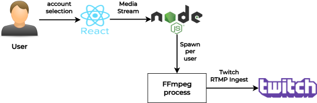

# LiveOverlay

LiveOverlay is a full-stack live streaming application that enables users to stream to Twitch directly from their browser.  
It supports multiple concurrent users, each with their own Twitch accounts, and allows dynamic control over stream sources and overlays.

The application is designed for **real-time, multi-user streaming**, with dynamic video overlays and seamless integration between frontend and backend services.

## Architecture

1. **User Interaction:**

   - Users select from pre-configured Twitch accounts and log in via the web interface.
   - Stream sources (webcam, screen, or images) are selected and managed directly in the browser.

2. **Frontend (React + WebSocket):**

   - Captures media from the user’s webcam, screen, or images and applies dynamic overlays.
   - Media stream is sent in real-time to the backend via **WebSocket**.

3. **Backend (Node.js + FFmpeg):**

   - Spawns an isolated **FFmpeg process per user** to handle their individual streams.
   - Receives media stream over WebSocket and pipes it to FFmpeg.
   - FFmpeg encodes and streams the media to **Twitch’s RTMP ingest server**.

4. **Streaming Output:**

   - Live stream is delivered to the user’s Twitch channel at 480p, ensuring smooth and efficient streaming performance.

5. **Deployment:**
   - Both frontend and backend are hosted on **Render** (free tier).
   - CI/CD handled via **GitHub Actions** for automatic deployments.

## Features

- **Real-time streaming to Twitch via RTMP protocol**
- **Multi-user architecture:** spawn isolated FFmpeg processes per user
- **Dynamic overlays:** add image and text overlays to live streams
- **Webcam and screen sharing integration**
- **JWT-based authentication with session management**
- **User-friendly interface with live preview and easy source switching**
- **Deployed fully on Render:** frontend and backend hosted with free services

## Tech Stack

- **Frontend:** React, Vite, Tailwind CSS
- **Backend:** Node.js, Express.js, Socket.io
- **Streaming:** FFmpeg, RTMP Protocol
- **Authentication:** JWT, Session management
- **Deployment:** Render (Frontend + Backend), GitHub Actions (CI/CD)
